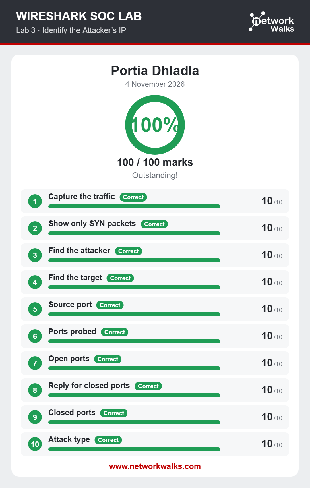
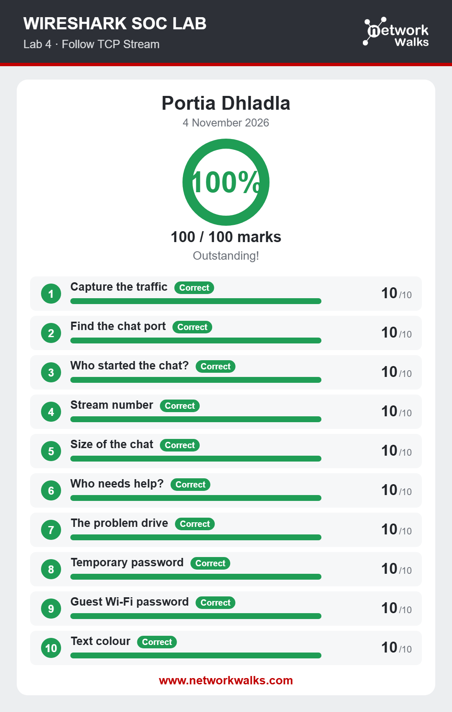
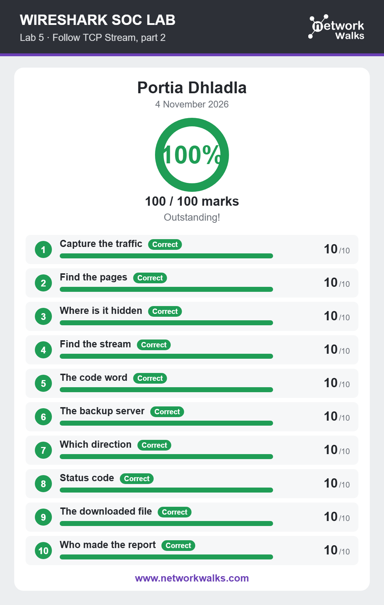
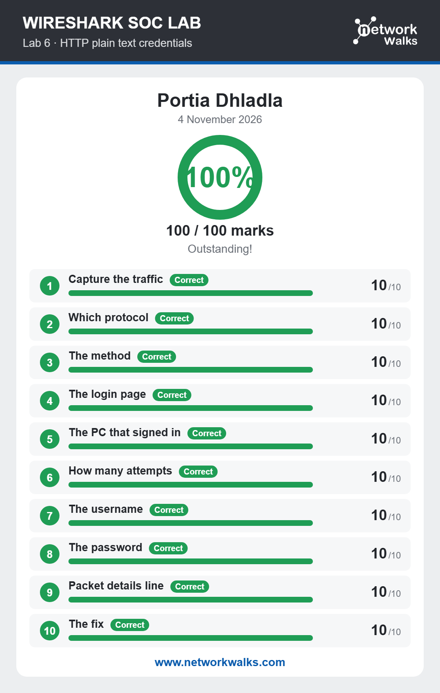
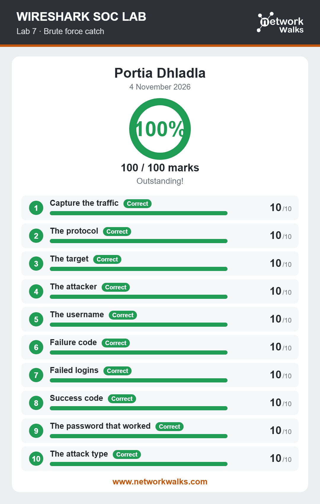
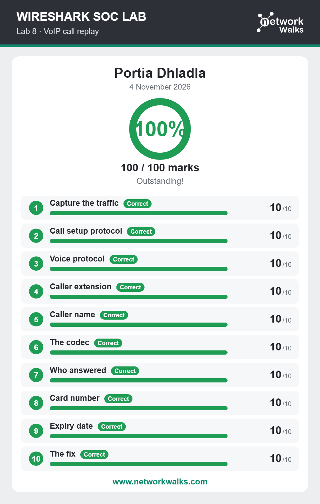

# Networkwalks-BO84_Week1_Projects

This project documents my hands-on experience completing six network traffic analysis and investigation labs during my cybersecurity learning journey.

The labs focused on analysing network traffic using Wireshark, identifying suspicious activity, investigating communication between devices, detecting credential exposure, recognising brute-force attacks, and examining VoIP communication.

The objective was to develop practical skills in network analysis, threat identification, traffic inspection, and basic incident investigation.

Lab 1: Identify the Attacker's IP Address

Objective: Analyse network traffic to identify a suspicious device responsible for scanning a target system.

ACTIVITIES
Examined TCP traffic using Wireshark.
Applied SYN flag filters to identify connection initiation attempts.
Analysed repeated SYN packets targeting different ports on the same device.
Compared source and destination IP addresses.
Identified the suspected attacker's IP address.
Investigated the target machine and the ports being scanned.

SKILLS DEVELOPED:

Identifying suspicious IP addresses.
Understanding TCP SYN packets.
Recognising TCP port-scanning behaviour.
Analysing source and destination addresses.
Understanding network reconnaissance techniques.

Lab 2: Follow TCP Stream – Part 1
Objective: Investigate TCP communication and reconstruct conversations between devices.

ACTIVITIES
- Identified traffic communicating over a non-standard web port.
- Examined TCP connections and source and destination ports.
- Used Wireshark's Follow TCP Stream feature.
- Reconstructed a plain-text conversation exchanged between two devices.
- Identified the client that initiated the connection.

  SKILLS DEVELOPED :
  
- Understanding TCP communication.
- Identifying client and server communication.
- Understanding ephemeral ports and service ports.
- Reconstructing application-level conversations using Follow TCP Stream.

  Lab 3: Follow TCP Stream – Part 2
Objective: Investigate web traffic and inspect HTTP communication to identify information exchanged between a client and a web server.

ACTIVITIES 
- Filtered and inspected HTTP requests.
- Examined GET requests and server responses.
- Used Follow TCP Stream to inspect the content exchanged.
- Investigated multiple web pages and their responses.
- Looked for information embedded within HTTP content, including potentially hidden information.

  SKILLS DEVELOPED :
  
- Analysing HTTP requests and responses.
- Understanding client-server communication.
- Inspecting web traffic and page content.
- Identifying potentially exposed information in network traffic.

   Lab 4: HTTP Plain-Text Credentials
Objective: Investigate how credentials can be exposed when authentication takes place over unencrypted HTTP.

ACTIVITIES
- Identified HTTP traffic containing login submissions.
- Inspected HTTP POST requests.
- Examined packet details to locate submitted form information.
- Investigated how usernames and passwords could be exposed in plain-text network traffic.
- Explored security measures that prevent credential interception.

  SKILLES DEVELOPED:
  
- Understanding HTTP authentication.
- Identifying POST requests.
- Recognising insecure credential transmission.
- Understanding the importance of HTTPS and TLS encryption.
- Learning how organisations can protect credentials in transit.

   Lab 5: Catch the Brute-Force Attacker
Objective: Identify suspicious FTP authentication activity and investigate repeated failed login attempts.

ACTIVITES
- Examined FTP traffic within the packet capture.
- Inspected FTP USER and PASS commands.
- Identified repeated authentication attempts.
- Investigated the source IP address responsible for the login attempts.
- Identified the FTP server being targeted.
- Examined FTP response codes to determine failed authentication attempts.

  SKILLS DEVELOPED :
  
- Understanding FTP communication.
- Recognising brute-force attack patterns.
- Analysing authentication attempts.
- Identifying suspicious source IP addresses.
- Understanding FTP response codes and failed logins.

  Lab 6: Catch the Call Scammer – VoIP Investigation
Objective: Investigate Voice over IP (VoIP) communication by analysing call signalling, voice packets, and call information.

ACTIVITIES
- Identified SIP (Session Initiation Protocol) packets used to establish a phone call.
- Examined SIP INVITE, Ringing, and OK messages.
- Identified RTP (Real-time Transport Protocol) packets carrying voice data.
- Inspected RTP payload types to identify the audio codec.
- Investigated the SIP INVITE to identify the calling extension.
- Used Wireshark's VoIP Calls feature to play and analyse the recorded conversation.
- Explored how encryption can protect VoIP calls from unauthorised interception

SKILLS DEVELOPED :

- Understanding VoIP communication.
- Analysing SIP signalling.
- Identifying RTP media traffic.
- Understanding audio codecs and RTP payload types.
- Reconstructing and listening to VoIP conversations.
- Understanding SRTP and TLS as security measures for VoIP communication.

  Key Learning Outcomes
Completing these six labs helped me develop practical skills in:

- Network traffic analysis using Wireshark.
- Identifying suspicious IP addresses and network activity.
- Analysing TCP connections and communication streams.
- Investigating HTTP requests and responses.
- Recognising exposed credentials and insecure protocols.
- Detecting brute-force authentication attempts.
- Analysing FTP, SIP, RTP, TCP, and HTTP traffic.
- Understanding the importance of encryption in network security.
- Using packet analysis to investigate potential security incidents.

  CONCLUSION 
These practical labs strengthened my understanding of how network communication works and how suspicious activity can be identified through packet analysis.

They also highlighted the importance of monitoring network traffic, securing communication protocols, protecting authentication information, and investigating unusual network behaviour.

This experience has contributed to my ongoing development in cybersecurity, particularly in network security, security operations, and incident investigation.

Learning by analysing real network traffic, one packet at a time.
